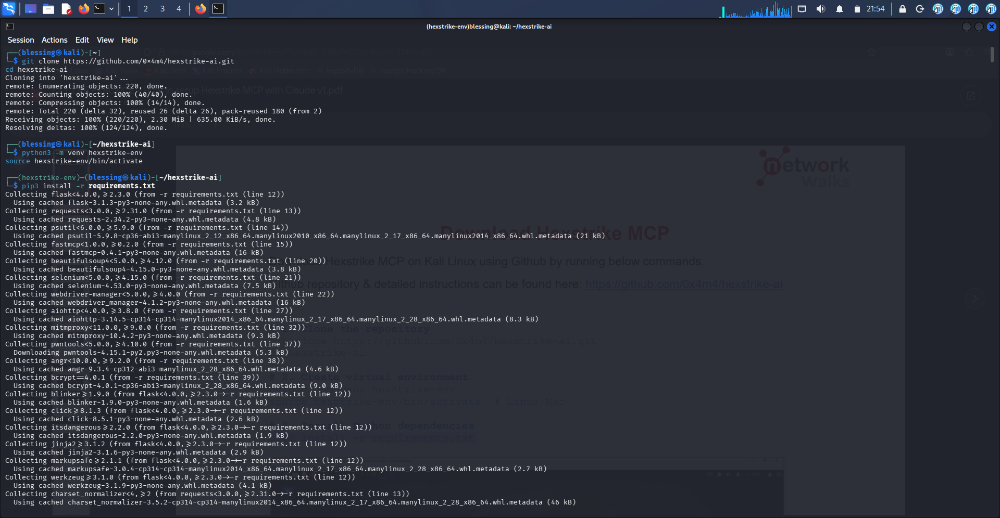
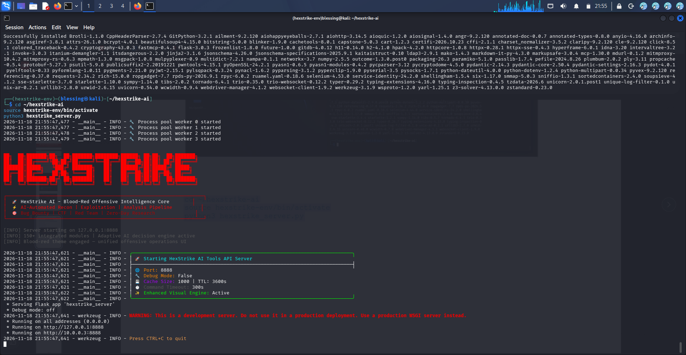
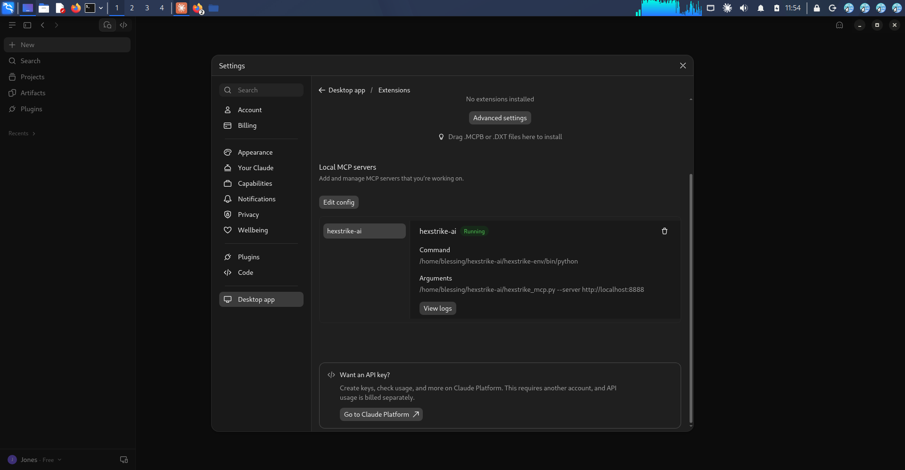
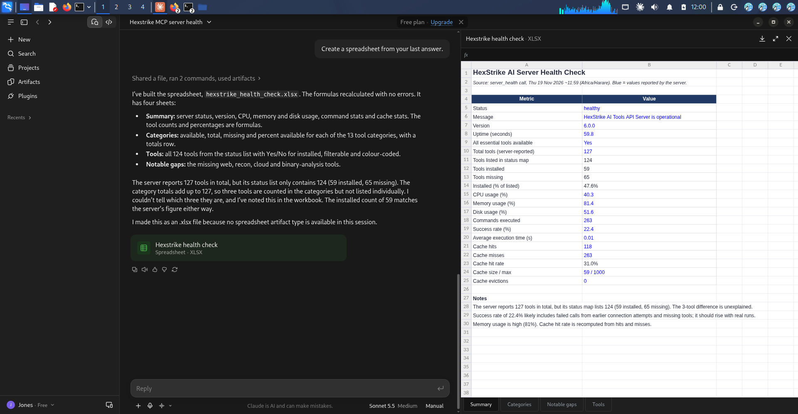
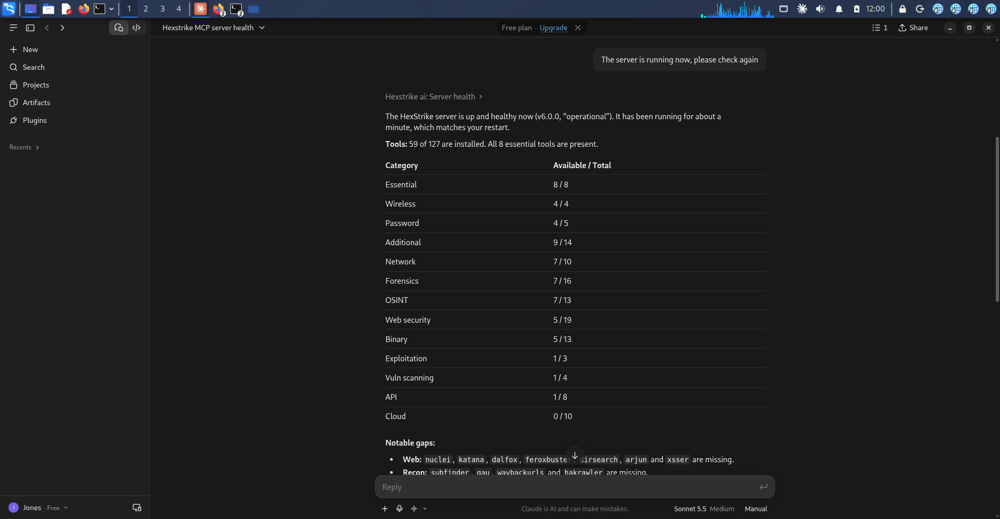
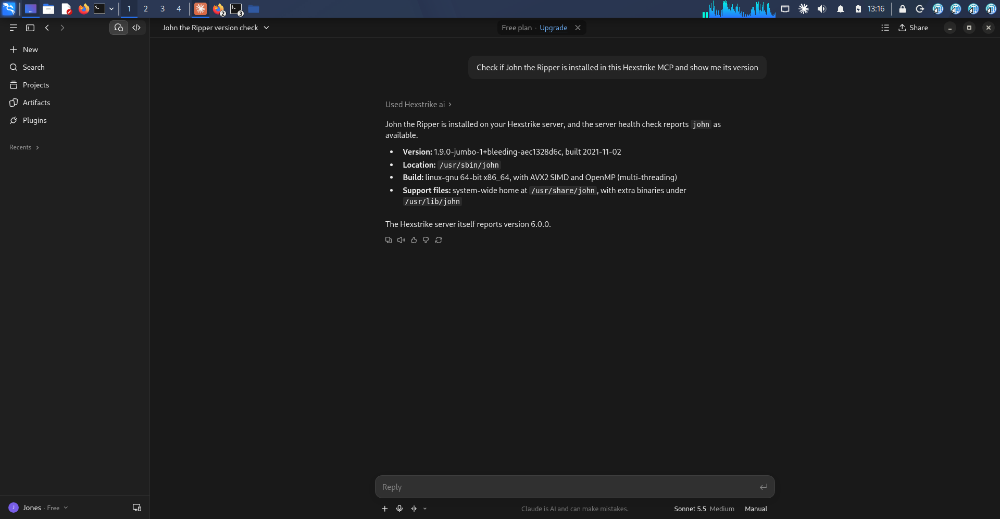
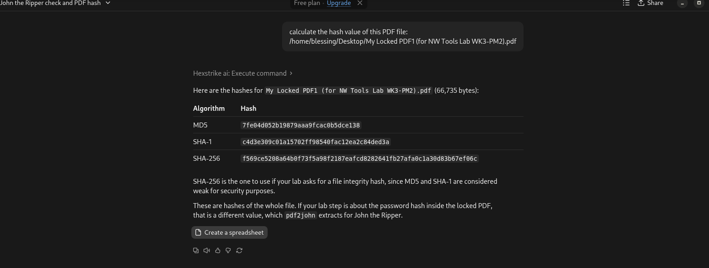
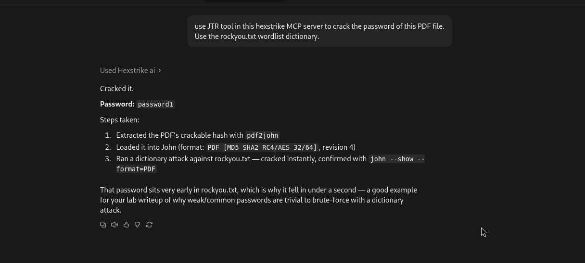

# JTR-Password-Cracking-AI-version
HexStrike AI is an offensive security intelligence core designed to bridge the gap between Large Language Models and local penetration testing environments. By utilizing a Model Context Protocol (MCP) server, HexStrike AI allows an LLM(egClaude) to directly execute terminal commands and automate complex offensive workflows on a local linux machine.

**Overview & Capabilities**
The HexStrike AI Tools API Server runs locally (default: 127.0.0.1:8888) and acts as a bridge. It exposes an API that the LLM can query to run commands, check system health, and execute binaries.

**Core Features Demonstrated:**
Natural Language Tool Execution: Instruct the AI to run specific binaries ( John the Ripper) with specific parameters and wordlists.
Automated Reconnaissance: Query system states, check installed tool versions, and verify environments.
Hash Generation & Extraction: Automate file hashing and hash extraction for cracking.
Automated Reporting: Generate structured .xlsx spreadsheets containing server health, tool availability metrics, and execution logs.
Exploit Research Integration: The AI can browse resources like Exploit-DB to gather intelligence on recent CVEs and vulnerabilities.

 **Walkthrough & Demonstrations**
1. Server Initialization
The HexStrike AI server is started via the Python virtual environment. It initializes worker processes and starts the Flask/WSGI server on port 8888.

Terminal showing the HexStrike AI server booting up and listening on 127.0.0.1:8888.

2. Connecting the AI (MCP Configuration)
In the AI client's settings, the MCP server is configured to point to the local HexStrike execution script. The status shows as "Running".

Configuring the local MCP server in the desktop app settings.

3. Automated Health Checks & Reporting
When prompted, the AI queries the HexStrike server API to generate a comprehensive health check. It pulls metrics such as CPU usage, memory usage, cache hits, and a complete inventory of installed vs. missing offensive tools.

4. Verifying Tooling (John the Ripper)
Before running an attack, the AI verified the presence and specific build of John the Ripper on the underlying system.

5. File Hashing & Analysis
Next, we asked the AI to calculate the cryptographic hashes of a locked PDF file to verify its integrity and prepare it for password cracking.

6. Automated Password Cracking (JTR & Rockyou)
Finally, we instructed the AI to use John the Ripper to crack the PDF's password using the standard rockyou.txt wordlist.

Steps taken by AI
Extracted the PDF's crackable hash using pdf2john.
Loaded it into John (format: PDF [MD5 SHA2 RC4/AES 32/64], revision 4).
Ran a dictionary attack against rockyou.txt.
Successfully cracked the password: password1.

